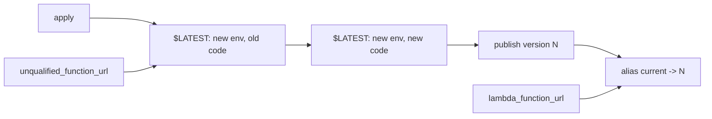
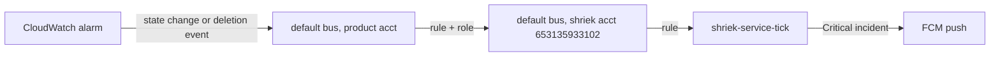
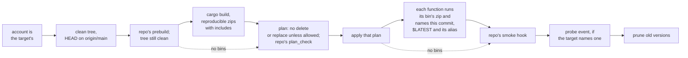

# agent-platform--tf-modules

Shared Terraform modules for the agent-platform services. Single source of
truth for the infrastructure stacks that were previously copy-pasted across
loom, model-gateway, granite, drive, pigeon, and bowerbird.

## Modules

### `rust-lambda-service`

The Lambda + IAM execution role + log group + public Function URL stack, plus
the AccessDeniedException CloudFormation workaround (a public Function URL
needs the `InvokedViaFunctionUrl` permission condition, which
`aws_lambda_permission` cannot express, so a tiny CloudFormation stack manages
it).

Service-specific resources (DynamoDB tables, S3 buckets, KMS keys, SNS topics,
API Gateway, CloudFront) stay in each service's own config and are wired into
the Lambda through `env` and `extra_policy_statements`.

```hcl
module "service" {
  source = "git::https://github.com/stackwell-labs/shared-terraform.git//modules/rust-lambda-service?ref=v0.1.0"

  app_name               = var.app_name
  service                = "loom"
  zip_path               = var.lambda_zip_path
  aws_region             = var.aws_region
  lambda_timeout_seconds = 60

  env = {
    RUST_LOG = "loom_service=info"
    # ...service env...
  }

  # Service-specific IAM beyond the base CloudWatch Logs grants:
  extra_policy_statements = [
    {
      Action   = ["dynamodb:GetItem", "dynamodb:PutItem"]
      Effect   = "Allow"
      Resource = aws_dynamodb_table.records.arn
    }
  ]
}
```

Its AWS provider constraint is `>= 5.0, < 7.0` (v0.20.0, shared-terraform#22),
as is `lambda-execution-role`'s, so a root can move to provider 6.x; before
v0.20.0 both pinned `~> 5.0`.

Outputs: `lambda_function_url`, `unqualified_function_url`,
`lambda_function_name`, `lambda_function_arn`, `lambda_invoke_arn`,
`lambda_alias_name`, `lambda_alias_arn`, `lambda_alias_invoke_arn`,
`lambda_role_arn`, `lambda_role_name`, `log_group_name`, `config_secret_arn`,
`config_secret_read_statement`.

**Traffic goes through an alias** (v0.18.0, shared-terraform#9). Lambda
applies a function's config and its code in two calls, so for 8–20 s of an
apply `$LATEST` starts the *previous* binary with the *new* env. If the deploy
dropped a var that binary's boot check requires, every cold start in that
window panics (drive and granite, 2026-11-14). The module now publishes a
version on every apply and moves the alias `current` to it once code and
config are both in, so nothing invoked through the alias sees the mix.



- `lambda_function_url` is now the **alias's** Function URL, a new URL. The
  old one stays as `unqualified_function_url` (still on `$LATEST`, still
  exposed to the hazard), so a bump plans only adds and one in-place change:
  nothing a caller uses goes away.
- Invoke the alias everywhere: point a CloudFront origin or health check at
  `lambda_function_url`, an EventBridge target at `lambda_alias_arn`, an API
  Gateway integration at `lambda_alias_invoke_arn`, each with its
  `aws_lambda_permission` given `qualifier = lambda_alias_name` (a permission
  on the function does not cover the alias). `lambda_function_arn` and
  `lambda_invoke_arn` still name `$LATEST`.
- Once no caller uses the old URL, set `unqualified_function_url = false`.
  That plans three plain deletes, which deploy-lambda applies only when that
  run names each one (shared-terraform#18):

  ```sh
  deploy-lambda live \
    --allow-delete 'module.<name>.aws_lambda_function_url.this[0]' \
    --allow-delete 'module.<name>.aws_lambda_permission.function_url_public[0]' \
    --allow-delete 'module.<name>.aws_cloudformation_stack.function_url_invoke_public[0]'
  ```
- Every apply keeps one more version (a 15 MB zip is 15 MB more of the
  account's code storage). `deploy-lambda` prunes them after each deploy
  (shared-terraform#20, below); a service deployed some other way keeps them
  all.

**Removing an env var takes two deploys** while anything still invokes
`$LATEST`: the unqualified URL or ARNs, and the very deploy that bumps to
v0.18.0, since the alias only serves from the version it publishes. First
deploy the code that no longer needs the var, then the Terraform that drops
it.

**The deployed commit** (v0.17.0, shared-terraform#8). `description` sets the
function's description. A service passes `"commit <sha>"` of the commit it
deploys: each published version keeps the description it was published with,
and the platform audit reads the commit a function runs from it
(agent-platform--ops#153). Empty (the default) changes nothing.

**No Function URL** (v0.15.0, pigeon#79). A service fronted by an API Gateway
passes `function_url = false`: the module then creates no Function URL and no
public-invoke permission (nor their CloudFormation stack), so the gateway, and
its throttle, is the only way in. `lambda_function_url` is then null, and
`function_url_cors` must stay unset. With the default (`true`) nothing changes:
`moved` blocks carry the three resources to their new `[0]` addresses.

**The config secret** (v0.14.0, shared-terraform#5). `config_secret` wires the
service's one Secrets Manager secret per plane (protocols
`docs/adr-secret-storage.md`), which shared-rust's `platform-secrets` reads at
cold start. The module grants the role `secretsmanager:GetSecretValue` on it
and sets `env_var` to its ARN. It never declares a secret version, so no value
reaches state: write values with platform-secrets'
`scripts/put-config-key.sh`.

```hcl
module "service" {
  # ...
  service       = "drive" # required with plane: it names the secret
  config_secret = { env_var = "DRIVE_CONFIG_SECRET", plane = "live" } # creates drive/live-config
}

# A secret that already exists (granite, compute-gateway, social-graph), or a
# second function sharing the first's: give its ARN instead of a plane.
module "trash_sweep" {
  # ...
  config_secret = { env_var = "DRIVE_CONFIG_SECRET", arn = module.service.config_secret_arn }
}
```

With `arn` the module creates no secret, so adopting an existing one needs no
`import`. Each function names its own env var, so a function that must not see
the service's keys can take a secret of its own by ARN instead. With
`role_arn` the module grants nothing: add `config_secret_read_statement` to
that role's `extra_policy_statements` where it is managed. The CI role's
describe/tag grant on the secret is the CI role's own config, not this module's.

**A role managed elsewhere.** By default the module creates the execution role
`<app_name>-lambda-role` and its policy, so the root applying it needs IAM
write on that role. If CI applies that root, a landed commit could then grant
the Lambda anything. To keep IAM out of CI, create the role in a root an admin
applies, with `lambda-execution-role`, and pass its ARN in:

```hcl
# IAM root, applied by an admin
module "lambda_role" {
  source = "git::https://github.com/stackwell-labs/shared-terraform.git//modules/lambda-execution-role?ref=v0.12.0"

  app_name                = "granite"
  aws_region              = var.aws_region
  extra_policy_statements = [ /* what the service's Lambda may touch */ ]
}

# CI root
module "service" {
  source   = "git::https://github.com/stackwell-labs/shared-terraform.git//modules/rust-lambda-service?ref=v0.12.0"
  app_name = "granite"
  role_arn = "arn:aws:iam::123456789012:role/granite-lambda-role" # the IAM root's role_arn output
  # ...no extra_policy_statements: passing both is an error...
}
```

With `role_arn` set the module creates no IAM, and the CI role needs only
`iam:GetRole` and `iam:PassRole` on that role. Without it, bumping the ref from
v0.2.0–v0.11.0 plans no change: `moved` blocks carry the role and policy into
`module.execution_role[0]`. A root that switches an existing role to
`role_arn` plans to delete it, so first take the role and policy out of its
state (`terraform state rm` on `module.<name>.module.execution_role[0]`) and
import them into the IAM root.

### `lambda-execution-role`

Only the execution role and its inline policy: the CloudWatch Logs grants
for `/aws/lambda/<app_name>` plus `extra_policy_statements`. Used by
`rust-lambda-service` when no `role_arn` is given, and by an IAM root directly.
Inputs `app_name`, `aws_region`, `extra_policy_statements`, `tags`.

Outputs: `role_arn`, `role_name`, `policy_json`.

### `github-oidc-deploy-role`

The GitHub Actions OIDC provider + a scoped deploy role assumable only by one
repo's branch via web identity. Single source of truth for the OIDC thumbprint
list. The role's *permissions* are the caller's responsibility (pass
`policy_json`); the module owns only the trust relationship.

```hcl
module "ci_deploy" {
  source = "git::https://github.com/stackwell-labs/shared-terraform.git//modules/github-oidc-deploy-role?ref=v0.1.0"

  repo        = "stackwell-labs/granite"
  owner_id    = 290129483 # gh api repos/stackwell-labs/granite --jq .owner.id
  repo_id     = 123456789 # gh api repos/stackwell-labs/granite --jq .id
  policy_json = data.aws_iam_policy_document.deploy_scoped.json
}
```

The trust accepts the branch's OIDC `sub` in both forms GitHub emits, each
matched exactly (`StringEquals`): `repo:<owner>/<name>:ref:refs/heads/<branch>`
and the immutable-ID `repo:<owner>@<owner_id>/<name>@<repo_id>:ref:...`.
`owner_id` and `repo_id` are required since v0.22.0 (shared-terraform#25).
Before that the immutable form was `<owner>@*/<name>@*`. In `StringLike`, `*`
matches any text, so another repo in the org could set a sub template that
matched it and assume the role. Callers on an older version should bump.

In an account that already has the GitHub OIDC provider, set
`create_oidc_provider = false` and pass `oidc_provider_arn`.

The module grants the role `iam:UpdateAssumeRolePolicy` on itself, so a role
that applies its own root can keep its trust up to date. When someone else
applies the role (an admin-applied root), set `trust_self_manage = false`:
there the grant would only let CI change who may assume the role. A `moved`
block makes a bump from v0.5.0 on the default plan no change.

The repo/branch pin admits every job on the branch, including test jobs that
run third-party code. To admit only the deploy job, pin the workflow it runs
(shared-terraform#7):

```hcl
  job_workflow_refs = [
    "stackwell-labs/shared-terraform/.github/workflows/terraform-deploy.yml@refs/heads/main",
  ]
```

STS checks GitHub's `job_workflow_ref` claim against these patterns
(StringLike), on top of the branch pin. For a job that calls a reusable
workflow, the claim names that workflow and the ref the caller gave after
`uses: ...@`, so the pattern must match that ref: `@refs/heads/main` for
`@main`, `@refs/tags/v0.16.0` for a tag. Left empty (the default), the trust
is unchanged. The pin narrows *which job* gets the token, not what runs inside
it: the deploy job's own build still runs its dependencies' build scripts,
unless it uses `prebuilt_artifact_name`.

Its AWS provider constraint is `>= 5.0, < 7.0` (v0.21.0, shared-terraform#23),
so a root can move to provider 6.x; before v0.21.0 it pinned `~> 5.0`.

Outputs: `role_arn`, `role_name`, `oidc_provider_arn`.

### `alarms-to-shriek`

Routes every CloudWatch alarm in an account to Shriek, which pages a phone:
an EventBridge rule on the default bus matches `CloudWatch Alarm State Change`
(ALARM and OK only) and `CloudWatch Alarm Configuration Change` with
operation `delete`, and forwards them to Shriek's bus through a role that can
only `events:PutEvents` there. Shriek opens a Critical incident on ALARM and
resolves it on OK, or on the alarm's deletion: a deleted alarm sends no OK,
so before v0.19.0 an alarm deleted while in ALARM left its incident open for
good (shriek#82).



Existing SNS/email actions are left alone, and alarms added later are covered
without any change here.

```hcl
module "alarms_to_shriek" {
  source      = "git::https://github.com/stackwell-labs/shared-terraform.git//modules/alarms-to-shriek?ref=v0.9.0"
  name_prefix = var.app_name
  tags        = local.common_tags
}
```

To keep some alarms off the phone, pass EventBridge wildcard patterns of alarm
names to leave out. They are dropped at the source (their deletions too), so
they never reach Shriek:

```hcl
  exclude_alarm_names = ["t_*_test_*"] # the 081 vault's test-plane tables
```

Bumping the ref to v0.19.0 or later from an earlier one plans one in-place
change, the rule's pattern, which now matches deletions too. The provider constraint is `>= 5.0, < 7.0`, so roots on AWS provider
5.x and 6.x can both use it.

Use it **once per account**, because the rule forwards every alarm in the
account. The account must also be listed in Shriek's `alarm_source_accounts`
(`stackwell-labs/shriek`, `service/infra/aws/variables.tf`). Shriek's bus policy
refuses accounts that are not listed, and the map gives each account its board
row name.

A CI deploy role applying this needs `events:{PutRule,DescribeRule,DeleteRule,
PutTargets,RemoveTargets,ListTargetsByRule,TagResource,UntagResource,
ListTagsForResource}` on the rule, and `iam:{CreateRole,GetRole,DeleteRole,
TagRole,UntagRole,PutRolePolicy,GetRolePolicy,DeleteRolePolicy,
ListRolePolicies,ListAttachedRolePolicies,ListInstanceProfilesForRole,PassRole}`
on the `<name_prefix>-alarms-to-shriek` role.

That IAM write lets whatever applies the root rewrite the role's trust and
policy. To keep it out of a CI-applied root, make the role in a root that an
admin applies, with the role-only module `alarms-to-shriek-role`, and pass its
ARN in. The module then creates no IAM, and the CI role needs only
`iam:PassRole` on the role (plus the `events:*` above):

```hcl
# admin-applied root
module "alarms_to_shriek_role" {
  source      = "git::https://github.com/stackwell-labs/shared-terraform.git//modules/alarms-to-shriek-role?ref=v0.11.0"
  name_prefix = var.app_name
}

# CI-applied root
module "alarms_to_shriek" {
  source      = "git::https://github.com/stackwell-labs/shared-terraform.git//modules/alarms-to-shriek?ref=v0.11.0"
  name_prefix = var.app_name
  role_arn    = "arn:aws:iam::<account>:role/<app_name>-alarms-to-shriek"
}
```

`role_arn` must be known at plan time (a literal or a remote-state output),
because it decides whether the role is created. Without it, the module calls
`alarms-to-shriek-role` itself, so the role's trust and permission live in one
place either way, and `moved` blocks make a bump from v0.9.0/v0.10.0 plan no
change.

To hand an existing instance's role to another root, move it before setting
`role_arn`, or the CI root plans to destroy it: import it into the admin root
(`module.alarms_to_shriek_role.aws_iam_role.forward`, ID
`<app_name>-alarms-to-shriek`, and `...aws_iam_role_policy.forward`, ID
`<app_name>-alarms-to-shriek:put-events-on-shriek-bus`), then
`terraform state rm module.alarms_to_shriek.module.role` in the CI root.

Outputs: `rule_arn`, `role_arn` (the role the target uses, given or created).
`alarms-to-shriek-role` outputs `role_arn`, `role_name`.

## `deploy-lambda`: the box deploy engine

`scripts/deploy-lambda` deploys a Rust Lambda service from the box
(shared-terraform#11), in place of each repo's own `deploy-live.sh` and
`build-lambda.sh`, and any other Terraform root of the service's (a web
hosting root, say) with the same guard. The repo describes its targets in
`.amber/deploy.toml`; the engine owns the safety steps, so every service gets
them by construction:



Run it from anywhere inside the service repo (Python 3.11+, `aws`,
`terraform`, `cargo` with the musl target):

```sh
python3 -I <(git -C ~/agent-platform/shared-terraform show \
  origin/main:scripts/deploy-lambda) live [--allow-delete <address>]... [--break-glass]
```

```toml
# .amber/deploy.toml
engine = "<40-hex shared-terraform commit on origin/main>"

[live]                                # a target: `deploy-lambda live`
account = "950916120278"              # the target's one home for its account id
profile = "compute-tmp"               # AWS_PROFILE for every aws/terraform call
region = "us-east-1"
infra = "infra/aws"                   # the Terraform root; init reads backend.hcl
var_file = "live.tfvars"              # optional, relative to infra
cargo_manifest = "Cargo.toml"         # with bins; neither for Terraform-only
allow_replace = []                    # optional: addresses the plan may replace
smoke = "scripts/smoke-deploy.sh"     # required, run after the checks
plan_env = "scripts/plan-env.sh"      # optional: KEY=value lines for terraform
plan_check = "scripts/plan-check.sh"  # optional: plan JSON on stdin; non-zero refuses
prebuild = "scripts/prebuild.sh"      # optional: run before cargo build (an SPA's bundle)
probe = "<service>"                   # optional: its probe event once live (probes table)

[live.bins.compute-gateway-service]   # a cargo bin, zipped as `bootstrap`
zip_var = "lambda_zip_path"           # the root's variable for its zip path
function_outputs = ["lambda_function_name"]  # the root's outputs naming the functions it runs
include = { "frontend/public" = "web/dist" }  # optional: zip path = repo-relative dir

[web]                                 # a Terraform-only target: no bins
account = "950916120278"
profile = "compute-tmp"
region = "us-east-1"
infra = "web/infra/aws"
smoke = "web/infra/aws/deploy-web.sh" # may publish, then check (below)
```

- **Pinned.** Whichever copy you invoke hands off to the copy at the
  manifest's `engine` commit (it must be on shared-terraform's origin/main), so
  a repo keeps the engine it was tested with until it moves the pin. It reads
  that copy from `~/agent-platform/shared-terraform`'s git objects, never its
  working tree, which nothing keeps current (`DEPLOY_LAMBDA_SHARED_TERRAFORM`
  points elsewhere, for the tests).
- **The root** must declare `deploy_commit` (the engine passes `-var=deploy_commit=<sha>`)
  and set each function's description to `commit <sha>` (rust-lambda-service's
  `description`), and must declare each bin's `zip_var` and every output in
  its `function_outputs`.
- **`function_outputs`** (shared-terraform#15) lists the root's outputs naming
  each function that runs the bin's zip; the engine checks every one runs that
  zip and is described `commit <sha>`: `$LATEST`, and, when the function has
  the alias `current` (rust-lambda-service v0.18.0+), the version that alias
  serves, which is what callers reach (shared-terraform#19). A function
  without that alias (one not on the module) is checked on `$LATEST`, which
  is then what serves; any error from Lambda other than "no such alias"
  refuses, as does an alias on `$LATEST`. One binary on two functions (an API and
  a worker that picks its entrypoint from an env var) lists both, so the
  second needs no second cargo bin. An output listed twice in a target is
  refused: one function runs one zip. It replaces `function_output` (one
  string), which is refused with a pointer here.
- **The build** is `cargo build --workspace --release --locked --target
  x86_64-unknown-linux-musl --bin …`. `--workspace` finds each bin in any
  workspace member, not only the default packages (shared-terraform#17), and
  cargo builds only the packages that own one. Keep bin names unique across
  the workspace: cargo only warns when two share one, and one binary
  overwrites the other. The engine asks `cargo metadata` where
  the binaries are, so `CARGO_TARGET_DIR` is honoured, and writes each zip
  under `<target dir>/deploy-lambda/<target>/<bin>/` with a fixed timestamp
  and mode 0755: the same binary gives the same zip.
- **`include`** (optional, per bin, shared-terraform#14) adds the files under
  each repo-relative dir to that bin's zip, under its zip path beside
  `bootstrap`, in sorted order, mode 0644, with the same fixed timestamp: the
  same files still give the same zip. Both paths are plain relative ones (no
  `..`, `.` or leading `/`); a zip path may not be or hold `bootstrap`, nor
  sit inside another. At build time it refuses a dir that is missing or empty,
  or holds a symlink or anything but files and dirs.
- **`prebuild`** (optional, shared-terraform#14) runs after the tree check and
  `plan_env`, before `cargo build`, e.g. `npm ci && npm run build:web` to make
  the files an `include` ships. A non-zero exit refuses. It may write only
  gitignored files: the engine checks the tree is still clean afterwards, so
  what deploys is still this commit plus what it built.
- **A Terraform-only target** (shared-terraform#13) has no `bins` and no
  `cargo_manifest`: the engine builds nothing and checks no function, and
  keeps every other step, `deploy_commit` included. A target with one of the
  two but not the other, or an empty `bins`, is refused. The engine deploys
  one root per target, so a service with two roots has two targets, deployed
  in turn (`deploy-lambda live`, then `deploy-lambda web`).
- **The plan guard** refuses any `delete`; a replace (delete and create) only
  of an address in `allow_replace`. A plain delete is refused even then, unless
  this run names its address with `--allow-delete` (shared-terraform#18). That
  is a one-shot flag, not manifest config: a migration step's deletes (retiring
  rust-lambda-service's unqualified URL, say) are allowed for the run that
  takes the step, never as a standing allowance. Each named address must be a
  plain delete in the plan, or the run is refused, so a typo or a step already
  taken can't pass as allowing nothing. The engine prints each delete it lets
  through. The flag needs an `engine` pin at or after the commit that added it.
- **`--break-glass`** (agent-platform--protocols#106) deploys HEAD without
  fetching origin or checking HEAD is on origin/main. It is for an outage that
  stops a fix landing: amber-git down, or ChirpAuth or amber-ci down so the
  gate on `main` can't answer. Without it ChirpAuth, whose outage that is,
  could only roll back, never ship its own fix (decision-profile P5). Every
  other step stays, the clean tree included, and the engine prints a
  `BREAK-GLASS` line naming the commit. It also sets
  `DEVBOX_TERRAFORM_BREAK_GLASS` to that commit for terraform alone (not the
  hooks), so the box's `terraform` wrapper, which makes the same origin/main
  check on `apply`, lets it through (devbox#212, shared-terraform#24); nobody
  exports anything by hand. Without the flag the engine strips an inherited
  export, and `plan_env` may not set any `DEVBOX_TERRAFORM_*`. Land that
  commit on `main` as soon as the gate can take it (amber-git-service
  `docs/break-glass.md`, §2). The flag needs an `engine` pin at or after the
  commit that added it; letting the wrapper through needs one at or after
  shared-terraform#24's.
- **Hooks** are executable files, relative to the repo root, run from it with
  `AWS_PROFILE`, `DEPLOY_TARGET`, `DEPLOY_COMMIT`, `DEPLOY_INFRA` (the root's
  absolute path, for `terraform -chdir="$DEPLOY_INFRA" output`) and
  `DEPLOY_REGION`. A missing or non-executable one refuses before anything
  touches AWS.
- **The smoke hook** runs last. A non-zero exit fails the deploy.
  Service-specific checks (an unauthenticated 401, a journey) live here. It
  may also publish what the applied root serves (a site's files to its
  bucket) and then check the live result: it runs only once the guarded
  apply and the function checks passed.
- **The probe event** (shared-terraform#21) goes out once the smoke hook
  passed, for a target that names `probe`: one event on the probes
  account's `probes-deploys` bus (source `stackwell.deploy`, `DetailType` the
  probe, detail `{"commit": "<sha>"}`), put with the target's profile, so
  that service's probe mission runs within minutes (probes README, "A probe
  run after each deploy (probes#20)"). The bus admits each service's account
  for its own `DetailType` only, so `probe` names the service the probes
  table lists for the target's account. The engine prints the event id. A
  put the bus doesn't take (a non-zero `FailedEntryCount`, or the call
  failing) fails the run, which says the commit is live anyway and skips
  pruning: a deploy that quietly started no probe would lose the outside
  check unseen. The field needs an `engine` pin at or after the commit that
  added it.
- **Pruning** (shared-terraform#20) runs last, once the smoke hook passed.
  rust-lambda-service publishes a version per apply, so for each checked
  function that has the alias `current` the engine keeps the newest 5
  published versions, and any version an alias names (its version or its
  routing config's second one), and deletes the rest, printing each. That
  leaves the alias 4 deploys to move back to. A failed deploy prunes
  nothing. A failed delete fails the run, which then says the commit is live
  anyway. Lambda can't restore a deleted version; its code is this repo at
  the commit its description names, rebuilt by the same reproducible zip.
- **`plan_env`** (optional, shared-terraform#12) runs before the build and
  prints `KEY=value` lines, e.g. a provider's API key read from Secrets
  Manager. Only the terraform calls in init, plan, show and apply get them
  (not aws, cargo or the other hooks), and the engine prints their names,
  never a value. It refuses a line that isn't `KEY=value` (without showing
  it), an empty value, a key set twice, and any `AWS_*`, `TF_*` or
  `DEVBOX_TERRAFORM_*` key: those decide the account, what terraform does and
  whether the box's wrapper lets an apply through, which the engine owns.
- **`plan_check`** (optional, shared-terraform#12) gets `terraform show -json`
  of the plan on stdin, after the engine's own guard passed. A non-zero exit
  refuses the apply; say why on stderr. A service-specific rule about the
  plan (shriek's: never unassign a healthchecks.io channel) lives here.

Tests: `python3 -m unittest discover -s scripts/tests -v` runs the engine
against a stubbed `aws`, `terraform` and `cargo`, one test per refusal
(amber-ci job `deploy-lambda`).

## Versioning

Tagged releases (`vMAJOR.MINOR.PATCH`). Consumers pin via `?ref=vX.Y.Z`.
