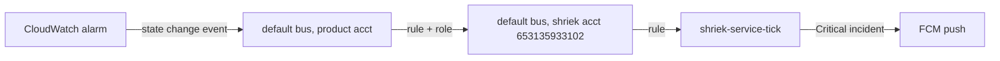

# agent-platform--tf-modules

Shared Terraform modules for the agent-platform services. Single source of
truth for the infrastructure stacks that were previously copy-pasted across
loom, model-gateway, granite, drive, pigeon, and bowerbird.

## Modules

### `rust-lambda-service`

The Lambda + IAM execution role + log group + public Function URL stack, plus
the AccessDeniedException CloudFormation workaround (a public Function URL
needs the `InvokedViaFunctionUrl` permission condition, which
`aws_lambda_permission` cannot express, so a tiny CloudFormation stack manages
it).

Service-specific resources (DynamoDB tables, S3 buckets, KMS keys, SNS topics,
API Gateway, CloudFront) stay in each service's own config and are wired into
the Lambda through `env` and `extra_policy_statements`.

```hcl
module "service" {
  source = "git::https://github.com/stackwell-labs/shared-terraform.git//modules/rust-lambda-service?ref=v0.1.0"

  app_name               = var.app_name
  service                = "loom"
  zip_path               = var.lambda_zip_path
  aws_region             = var.aws_region
  lambda_timeout_seconds = 60

  env = {
    RUST_LOG = "loom_service=info"
    # ...service env...
  }

  # Service-specific IAM beyond the base CloudWatch Logs grants:
  extra_policy_statements = [
    {
      Action   = ["dynamodb:GetItem", "dynamodb:PutItem"]
      Effect   = "Allow"
      Resource = aws_dynamodb_table.records.arn
    }
  ]
}
```

Outputs: `lambda_function_url`, `lambda_function_name`, `lambda_function_arn`,
`lambda_invoke_arn`, `lambda_role_arn`, `lambda_role_name`, `log_group_name`.

### `github-oidc-deploy-role`

The GitHub Actions OIDC provider + a scoped deploy role assumable only by one
repo's branch via web identity. Single source of truth for the OIDC thumbprint
list. The role's *permissions* are the caller's responsibility (pass
`policy_json`); the module owns only the trust relationship.

```hcl
module "ci_deploy" {
  source = "git::https://github.com/stackwell-labs/shared-terraform.git//modules/github-oidc-deploy-role?ref=v0.1.0"

  repo        = "stackwell-labs/granite"
  policy_json = data.aws_iam_policy_document.deploy_scoped.json
}
```

In an account that already has the GitHub OIDC provider, set
`create_oidc_provider = false` and pass `oidc_provider_arn`.

Outputs: `role_arn`, `role_name`, `oidc_provider_arn`.

### `alarms-to-shriek`

Routes every CloudWatch alarm in an account to Shriek, which pages a phone:
an EventBridge rule on the default bus matches `CloudWatch Alarm State Change`
(ALARM and OK only) and forwards it to Shriek's bus through a role that can
only `events:PutEvents` there. Shriek opens a Critical incident on ALARM and
resolves it on OK.



Existing SNS/email actions are left alone, and alarms added later are covered
without any change here.

```hcl
module "alarms_to_shriek" {
  source      = "git::https://github.com/stackwell-labs/shared-terraform.git//modules/alarms-to-shriek?ref=v0.9.0"
  name_prefix = var.app_name
  tags        = local.common_tags
}
```

Use it **once per account**, because the rule forwards every alarm in the
account. The account must also be listed in Shriek's `alarm_source_accounts`
(`stackwell-labs/shriek`, `service/infra/aws/variables.tf`). Shriek's bus policy
refuses accounts that are not listed, and the map gives each account its board
row name.

A CI deploy role applying this needs `events:{PutRule,DescribeRule,DeleteRule,
PutTargets,RemoveTargets,ListTargetsByRule,TagResource,UntagResource,
ListTagsForResource}` on the rule, and `iam:{CreateRole,GetRole,DeleteRole,
TagRole,UntagRole,PutRolePolicy,GetRolePolicy,DeleteRolePolicy,
ListRolePolicies,ListAttachedRolePolicies,ListInstanceProfilesForRole,PassRole}`
on the `<name_prefix>-alarms-to-shriek` role.

Outputs: `rule_arn`, `role_arn`.

## Versioning

Tagged releases (`vMAJOR.MINOR.PATCH`). Consumers pin via `?ref=vX.Y.Z`.
